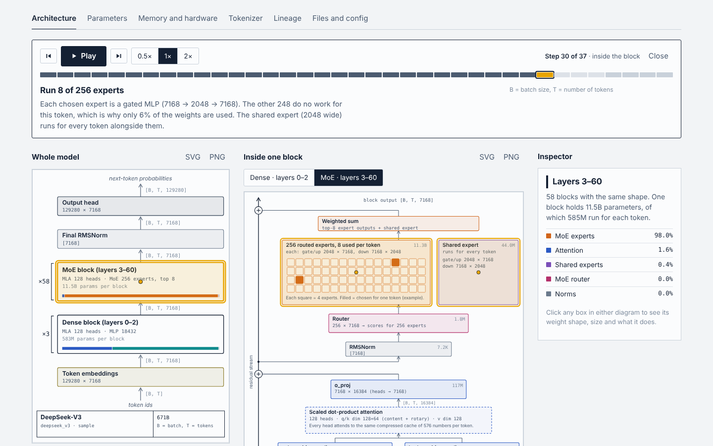
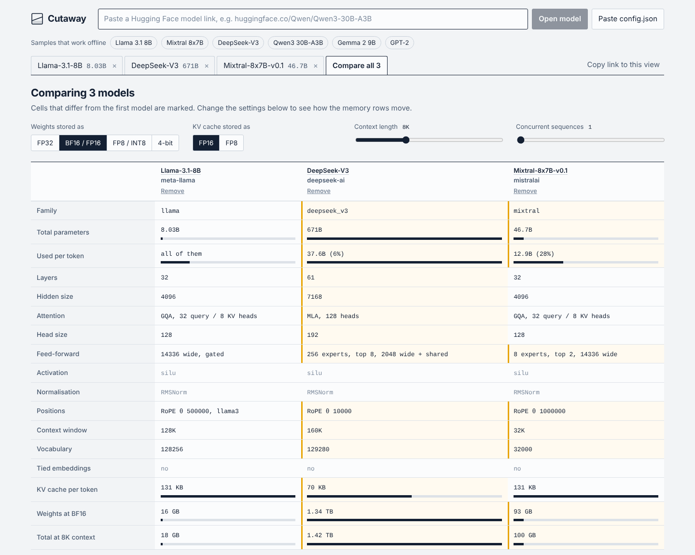

# Cutaway

**Paste a Hugging Face model link and see how it is built.**

Cutaway reads a model's published files and draws what is inside: every layer, the tensor shape at every step, where the parameters live, how much memory it needs, and how it differs from other models. No downloads, no account, no server.

**Live:** https://YOUR-URL.vercel.app



## What you get

- **Architecture, drawn to scale of detail.** A whole-model stack and a zoomed single block, with `[B, T, d]` shapes on every arrow and exact weight shapes on every box. Dense, MoE, grouped-query and multi-head latent attention are all drawn as they really are.
- **Follow a token through the model.** An animated walkthrough: token ids go in, probabilities come out. Each step highlights the layer, says what it does in plain language, and shows the tensor shape in and out. Arrow keys step, space plays.
- **Click anything.** The inspector explains each tensor, its size and its share of the model.
- **Parameters.** Total vs. used per token, split into embeddings, attention, MLP, experts, router and norms.
- **Memory and hardware.** Weights at FP32, BF16, FP8/INT8 and 4-bit, plus the KV cache for your context length and batch size.
- **Compare models.** Open several models and get a side-by-side table that marks every difference, with matching layer stacks and parameter bars.
- **Tokenizer, lineage, files.** Special tokens and chat template, base model and fine-tunes, and the real tensor names and shapes read from the weight files.
- **Export and share.** Download any diagram as SVG or PNG. The address bar always reproduces what you are looking at.



## How it works

Everything runs in your browser. For a link like `huggingface.co/org/model`, Cutaway fetches:

1. the model's metadata from the Hub API,
2. `config.json`, which defines the architecture,
3. `tokenizer_config.json`, for tokens and the chat template,
4. the header of the first `.safetensors` file, using an HTTP range request, so it never downloads weights. These real tensor shapes are used to check the numbers derived from the config.

Parameter counts are computed from the config and cross-checked against the totals the Hub publishes. For gated or private models, use **Paste config.json** and nothing leaves your machine.

Six sample configs are bundled so the app works offline.

## Supported models

Decoder-only transformers: Llama-style, GPT-2, Gemma, Qwen, Mistral and Mixtral, DeepSeek (MLA and MoE with shared experts), and similar. Configs that are not transformers, such as Mamba-style state-space models, get a clear message instead of a wrong drawing. Multi-token-prediction layers are listed in a note but not drawn.

## Run it

```bash
npm install
npm run dev      # http://localhost:5173
npm test         # parameter counts vs. published totals, KV-cache sizes vs. their formulas
npm run build    # writes a single self-contained dist/index.html
```

## Deploy

It is a static site. On Vercel, import the repository and keep the defaults: framework **Vite**, build command `npm run build`, output directory `dist`.

## Stack

React, TypeScript and Vite. The diagrams are hand-written SVG, with no charting or diagram library. Fonts are Schibsted Grotesk and JetBrains Mono.

## Project layout

```
src/lib/arch.ts      config.json -> architecture, parameter and activation counts
src/lib/hf.ts        Hub fetching, safetensors header reading, tokenizer config
src/lib/memory.ts    weight and KV-cache sizes
src/lib/flow.ts      the steps of the data-flow walkthrough
src/components/      ArchStack, BlockDiagram, FlowMarks, FlowPlayer, CompareView, ...
test/                arch.test.ts
```
